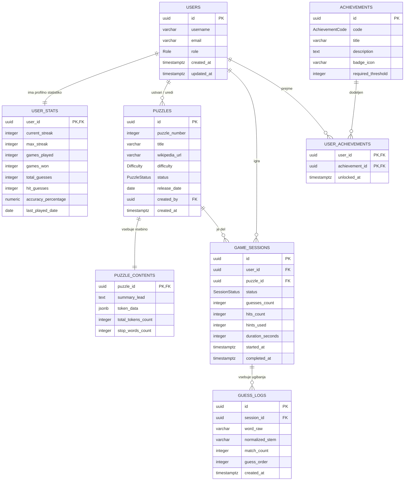

# 3. Podatkovni model rešitve

Podatkovni model je zasnovan za relacijsko podatkovno bazo **PostgreSQL** (preko **Supabase** in **Prisma ORM**). Model omogoča varno upravljanje uporabnikov, vodenje statistike, shranjevanje dnevnih ugank ter podrobno beleženje iger in posameznih ugibanj.

Za zagotavljanje visoke stopnje integritete podatkov in tipske varnosti v TypeScriptu model uporablja izvorne **PostgreSQL ENUM tipe** za vsa polja z vnaprej določenim naborom vrednosti (vloge, težavnost, statusi).

---

## Data Model - Entitete in povezave



---

## Našteti tipi (ENUM)

Vsi fiksni nabori stanj in vlog so definirani kot PostgreSQL našteti tipi (`ENUM`), kar preprečuje vnos neveljavnih vrednosti in samodejno generira TypeScript tipe v Prismi:

### 1. `Role` (Uporabniške vloge)
```prisma
enum Role {
  PLAYER   // Registriran igralec
  EDITOR   // Urednik vsebin
  ADMIN    // Skrbnik sistema
}
```

### 2. `Difficulty` (Težavnost uganke)
```prisma
enum Difficulty {
  EASY     // Lahka (krajši članek, več vnaprej razkritih besed)
  MEDIUM   // Srednja (standardni dnevni članek)
  HARD     // Težka (obsežno strokovno ali zgodovinsko besedilo)
}
```

### 3. `PuzzleStatus` (Status uganke)
```prisma
enum PuzzleStatus {
  DRAFT       // V pripravi (viden le uredniku)
  SCHEDULED   // Načrtovan za objavo na določen datum
  PUBLISHED   // Javna dnevna uganka
  ARCHIVED    // Pretekla uganka v arhivu
}
```

### 4. `SessionStatus` (Status igralne seje)
```prisma
enum SessionStatus {
  IN_PROGRESS // Reševanje v teku
  WON         // Uspešno rešeno (naslov uganjen)
  ABANDONED   // Prekinjena igra
}
```

### 5. `AchievementCode` (Kode dosežkov)
```prisma
enum AchievementCode {
  FIRST_WIN      // Prva uspešno rešena uganka
  STREAK_7       // 7 dni zaporednih zmag
  STREAK_30      // 30 dni zaporednih zmag
  NO_HINTS       // Zmaga brez uporabe namigov
  FAST_SOLVER    // Zmaga v manj kot 3 minutah
  HIGH_ACCURACY  // Zmaga z natančnostjo nad 80 %
}
```

---

## Opis tabel in polj

### 1. `users` (Uporabniški profili)

Tabela hrani javne podatke o registriranih uporabnikih, njihova uporabniška imena in vloge. Povezana je s shemo `auth.users` v Supabase, ki samodejno in varno upravlja poverilnice (gesla).

| Polje        | Tip podatka    | Omejitve                                     | Opis                                                    |
| :----------- | :------------- | :------------------------------------------- | :------------------------------------------------------ |
| `id`         | `UUID`         | PK, FK -> `auth.users(id)` ON DELETE CASCADE | Enolični identifikator (skladno s Supabase Auth).      |
| `username`   | `VARCHAR(50)`  | NOT NULL, UNIQUE                             | Uporabniško ime za prikaz v igri in na lestvici.        |
| `email`      | `VARCHAR(255)` | NOT NULL, UNIQUE                             | Elektronski naslov uporabnika.                          |
| `role`       | `Role (ENUM)`  | NOT NULL, DEFAULT 'PLAYER'                   | Vloga uporabnika: `PLAYER`, `EDITOR`, `ADMIN`.          |
| `created_at` | `TIMESTAMPTZ`  | NOT NULL, DEFAULT NOW()                      | Datum in čas registracije.                              |
| `updated_at` | `TIMESTAMPTZ`  | NOT NULL, DEFAULT NOW()                      | Datum in čas zadnje spremembe profila.                  |

---

### 2. `user_stats` (Statistika igralca)

Tabela v razmerju 1:1 z uporabnikom. Hrani seštevke rezultatov za hiter prikaz na profilu in lestvici.

| Polje                 | Tip podatka    | Omejitve                                | Opis                                                       |
| :-------------------- | :------------- | :-------------------------------------- | :--------------------------------------------------------- |
| `user_id`             | `UUID`         | PK, FK -> `users(id)` ON DELETE CASCADE | Povezava na uporabnika.                                    |
| `current_streak`      | `INTEGER`      | NOT NULL, DEFAULT 0                     | Trenutni zaporedni dnevi z zmago.                          |
| `max_streak`          | `INTEGER`      | NOT NULL, DEFAULT 0                     | Najdaljši doseženi niz zaporednih zmag.                    |
| `games_played`        | `INTEGER`      | NOT NULL, DEFAULT 0                     | Število vseh začetih iger.                                 |
| `games_won`           | `INTEGER`      | NOT NULL, DEFAULT 0                     | Število vseh dobljenih iger.                               |
| `total_guesses`       | `INTEGER`      | NOT NULL, DEFAULT 0                     | Skupno število vseh vpisanih besed.                        |
| `hit_guesses`         | `INTEGER`      | NOT NULL, DEFAULT 0                     | Število zadetkov (beseda je bila v besedilu).              |
| `accuracy_percentage` | `NUMERIC(5,2)` | NOT NULL, DEFAULT 0.00                  | Odstotek uspešnih ugibanj (`hit_guesses / total_guesses`). |
| `last_played_date`    | `DATE`         | NULL                                    | Datum zadnje odigrane igre (za računanje zaporednih dni).  |

---

### 3. `puzzles` (Dnevne uganke / Članki)

Tabela predstavlja posamezen cenzurirani članek oziroma dnevno uganko.

| Polje           | Tip podatka           | Omejitve                      | Opis                                                |
| :-------------- | :-------------------- | :---------------------------- | :-------------------------------------------------- |
| `id`            | `UUID`                | PK, DEFAULT gen_random_uuid() | Enolični identifikator uganke.                      |
| `puzzle_number` | `INTEGER`             | NOT NULL, UNIQUE              | Zaporedna številka dneva (npr. #42).                |
| `title`         | `VARCHAR(255)`        | NOT NULL                      | Resnični naslov članka (geslo, ki ga igralec išče). |
| `wikipedia_url` | `VARCHAR(500)`        | NOT NULL                      | Izvirna povezava do članka na Wikipediji.           |
| `difficulty`    | `Difficulty (ENUM)`   | NOT NULL, DEFAULT 'MEDIUM'    | Težavnost: `EASY`, `MEDIUM`, `HARD`.                |
| `status`        | `PuzzleStatus (ENUM)` | NOT NULL, DEFAULT 'DRAFT'     | Status: `DRAFT`, `SCHEDULED`, `PUBLISHED`, `ARCHIVED`. |
| `release_date`  | `DATE`                | NOT NULL, UNIQUE              | Datum, ko je uganka na vrsti za igranje.            |
| `created_by`    | `UUID`                | NULL, FK -> `users(id)`       | Urednik, ki je pripravil uganko.                    |
| `created_at`    | `TIMESTAMPTZ`         | NOT NULL, DEFAULT NOW()       | Datum in čas vnosa v bazo.                          |

---

### 4. `puzzle_contents` (Besedilo in žetoni uganke)

Tabela v razmerju 1:1 z uganko, ki hrani polno besedilo in podatke o besedah.

| Polje                | Tip podatka | Omejitve                                  | Opis                                                           |
| :------------------- | :---------- | :---------------------------------------- | :------------------------------------------------------------- |
| `puzzle_id`          | `UUID`      | PK, FK -> `puzzles(id)` ON DELETE CASCADE | Povezava na uganko.                                            |
| `summary_lead`       | `TEXT`      | NOT NULL                                  | Uvodni del članka pred cenzuro.                                |
| `token_data`         | `JSONB`     | NOT NULL                                  | Podatki o posameznih besedah (položaj, začetno stanje, koren). |
| `total_tokens_count` | `INTEGER`   | NOT NULL                                  | Skupno število besed v članku.                                 |
| `stop_words_count`   | `INTEGER`   | NOT NULL                                  | Število vnaprej razkritih besed (vezniki, predlogi).           |

---

### 5. `game_sessions` (Igralne seje)

Tabela beleži vsak poskus reševanja določene uganke s strani posameznega igralca.

| Polje              | Tip podatka            | Omejitve                                   | Opis                                                   |
| :----------------- | :--------------------- | :----------------------------------------- | :----------------------------------------------------- |
| `id`               | `UUID`                 | PK, DEFAULT gen_random_uuid()              | Enolični identifikator seje.                           |
| `user_id`          | `UUID`                 | NULL, FK -> `users(id)` ON DELETE SET NULL | Igralec (lahko je NULL pri gostih).                    |
| `puzzle_id`        | `UUID`                 | NOT NULL, FK -> `puzzles(id)`              | Uganka, ki se rešuje.                                  |
| `status`           | `SessionStatus (ENUM)` | NOT NULL, DEFAULT 'IN_PROGRESS'            | Stanje seje: `IN_PROGRESS`, `WON`, `ABANDONED`.        |
| `guesses_count`    | `INTEGER`              | NOT NULL, DEFAULT 0                        | Število poskusov v tej igri.                           |
| `hits_count`       | `INTEGER`              | NOT NULL, DEFAULT 0                        | Število zadetih besed v tej igri.                      |
| `hints_used`       | `INTEGER`              | NOT NULL, DEFAULT 0                        | Število uporabljenih namigov.                          |
| `duration_seconds` | `INTEGER`              | NOT NULL, DEFAULT 0                        | Porabljen čas reševanja v sekundah.                    |
| `started_at`       | `TIMESTAMPTZ`          | NOT NULL, DEFAULT NOW()                    | Čas začetka igre.                                      |
| `completed_at`     | `TIMESTAMPTZ`          | NULL                                       | Čas zaključka (ob zmagi).                              |

---

### 6. `guess_logs` (Zgodovina ugibanj)

Vsaka vnesena beseda se zabeleži, kar omogoča nadaljevanje igre in preverjanje rezultatov.

| Polje             | Tip podatka    | Omejitve                                              | Opis                                             |
| :---------------- | :------------- | :---------------------------------------------------- | :----------------------------------------------- |
| `id`              | `UUID`         | PK, DEFAULT gen_random_uuid()                         | Enolični identifikator vnosa.                    |
| `session_id`      | `UUID`         | NOT NULL, FK -> `game_sessions(id)` ON DELETE CASCADE | Povezava na igralno sejo.                        |
| `word_raw`        | `VARCHAR(100)` | NOT NULL                                              | Točno vpisana beseda igralca.                    |
| `normalized_stem` | `VARCHAR(100)` | NOT NULL                                              | Izračunan koren besede.                          |
| `match_count`     | `INTEGER`      | NOT NULL, DEFAULT 0                                   | Število odprtih besed v besedilu s tem poskusom. |
| `guess_order`     | `INTEGER`      | NOT NULL                                              | Zaporedna številka poskusa v igri (1, 2, 3...).  |
| `created_at`      | `TIMESTAMPTZ`  | NOT NULL, DEFAULT NOW()                               | Čas vpisa besede.                                |

---

### 7. `achievements` (Dosežki in značke)

Tabela definira nabor vseh možnih značk in dosežkov, ki jih igralci lahko odklenejo skozi igro.

| Polje                | Tip podatka    | Omejitve                      | Opis                                                                          |
| :------------------- | :------------- | :---------------------------- | :---------------------------------------------------------------------------- |
| `id`                 | `UUID`                 | PK, DEFAULT gen_random_uuid() | Enolični identifikator dosežka.                                               |
| `code`               | `AchievementCode (ENUM)` | NOT NULL, UNIQUE            | Enolična koda dosežka (npr. `STREAK_7`, `FAST_SOLVER`, `NO_HINTS`).           |
| `title`              | `VARCHAR(100)` | NOT NULL                      | Prikazno ime dosežka.                                                         |
| `description`        | `TEXT`         | NOT NULL                      | Podroben opis pogoja za pridobitev značke.                                    |
| `badge_icon`         | `VARCHAR(100)` | NOT NULL                      | Oznaka ali pot do ikone značke za prikaz v vmesniku.                          |
| `required_threshold` | `INTEGER`      | NOT NULL, DEFAULT 1           | Zahtevan številčni prag za odklep (npr. 7 zmag, 20 poskusov).                 |
| `created_at`         | `TIMESTAMPTZ`  | NOT NULL, DEFAULT NOW()       | Datum in čas dodajanja dosežka v sistem.                                      |

---

### 8. `user_achievements` (Odklenjeni dosežki uporabnikov)

Povezovalna tabela (N:M razmerje) med uporabniki in dosežki, ki beleži, kateri igralec je odklenil kateri dosežek in kdaj.

| Polje            | Tip podatka   | Omejitve                                                          | Opis                                                         |
| :--------------- | :------------ | :---------------------------------------------------------------- | :----------------------------------------------------------- |
| `user_id`        | `UUID`        | PK (sestavljen ključ), FK -> `users(id)` ON DELETE CASCADE        | Povezava na igralca, ki je osvojil dosežek.                  |
| `achievement_id` | `UUID`        | PK (sestavljen ključ), FK -> `achievements(id)` ON DELETE CASCADE | Povezava na osvojeni dosežek.                                |
| `unlocked_at`     | `TIMESTAMPTZ` | NOT NULL, DEFAULT NOW()                                           | Datum in čas, ko je bil pogoj izpolnjen in dosežek odklenjen.|

---

## Povezave med entitetami (Kardinalnosti)

1. **`users` — `user_stats` (1 : 1):** Vsak registriran uporabnik ima točno en zapis s svojo skupno statistiko.
2. **`users` — `puzzles` (1 : N):** Urednik lahko ustvari in uredi več ugank.
3. **`users` — `game_sessions` (1 : N):** Posamezen igralec ima lahko zabeleženih več igralnih sej.
4. **`puzzles` — `puzzle_contents` (1 : 1):** Vsaka uganka ima natanko eno vsebino z besedilom in žetoni.
5. **`puzzles` — `game_sessions` (1 : N):** Enako uganko rešuje več različnih igralcev.
6. **`game_sessions` — `guess_logs` (1 : N):** Posamezna igra vsebuje seznam vseh vpisanih besed.
7. **`users` — `achievements` (N : M prek `user_achievements`):** Igralec lahko odklene več dosežkov, isti dosežek pa lahko doseže več igralcev.
