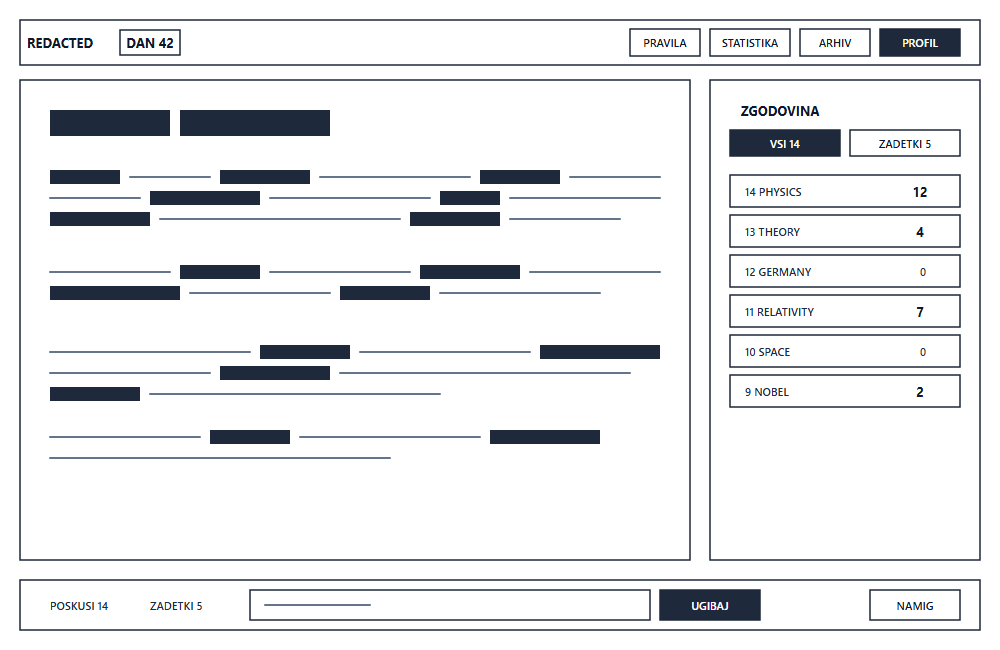
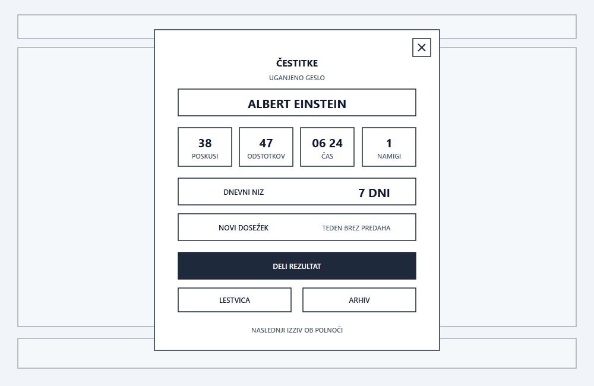
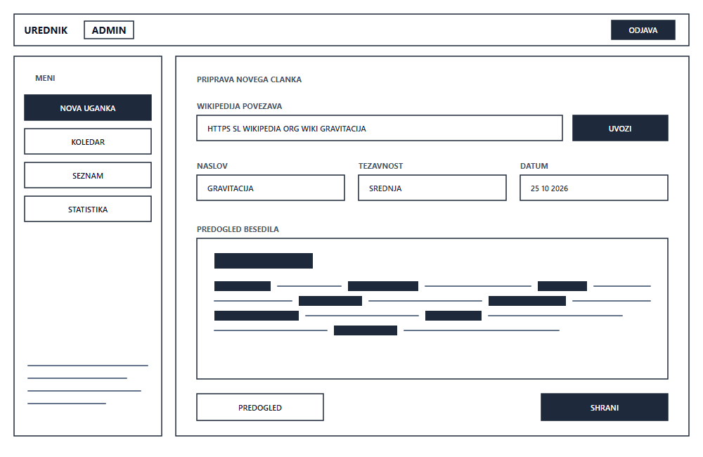
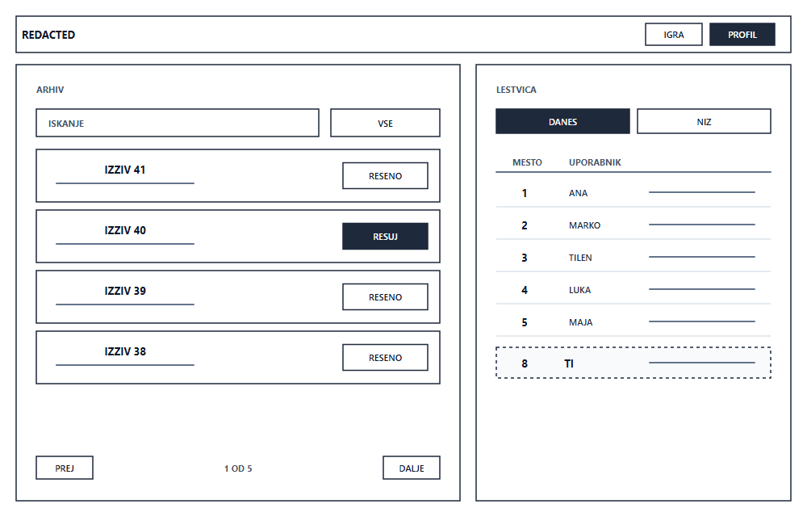

# 6. Žični modeli (Wireframes)

Dokument vsebuje vizualne žične modele (wireframes), ki prikazujejo razporeditev elementov, informacijsko arhitekturo in uporabniško izkušnjo spletne aplikacije REDACTED. 

Vsi žični modeli so izdelani kot preprosti, shematski osnutki v formatu PNG in vektorskem formatu SVG ter so shranjeni v mapi `docs/wireframes/`.

---

## 1. Glavni igralni zaslon (Desktop vmesnik)

Glavni zaslon predstavlja osrednje okolje, v katerem igralec preživi največ časa pri reševanju dnevnega izziva.

### Opis in ključni elementi zaslona:
* **Zgornja vrstica (Glava):**
  * Naziv aplikacije REDACTED s številko današnje uganke (DAN 42).
  * Navigacijski gumbi: PRAVILA, STATISTIKA, ARHIV ter uporabniški PROFIL.
* **Osrednji cenzurirani dokument:**
  * Prikaz članka v obliki shematskega dokumenta.
  * Skrite besede so ponazorjene s črnimi bloki ustrezne dolžine posamezne besede.
  * Vidne besede in vezniki so ponazorjeni s preprostimi linijami.
  * Zgoraj je cenzuriran naslov, ki ga mora igralec ugotoviti za zmago.
* **Desna stranska vrstica (Zgodovina poskusov):**
  * Seznam vnesenih besed z zabeleženim številom najdb v besedilu (npr. PHYSICS 12, THEORY 4, GERMANY 0).
  * Možnost filtriranja med vsemi poskusi (VSI) in zadetki (ZADETKI).
* **Spodnja vnosna vrstica:**
  * Števci poskusov in števila zadetkov.
  * Vnosno polje za vpis besed z gumbom UGIBAJ.
  * Gumb za dostop do pomoči (NAMIG).

**Povezane uporabniške zgodbe:** US-01, US-02, US-03, US-04, US-13.

---

## 2. Zaključek igre in pregled statistike (Modalno okno)

Zaslon se samodejno odpre ob zmagi, ko igralec uspešno ugotovi skriti naslov članka.

### Opis in ključni elementi zaslona:
* **Ozadje:** Glavni igralni zaslon v ozadju je zamegljen.
* **Osrednje modalno okno:**
  * Naslov ČESTITKE in okvir z razkritim geslom (ALBERT EINSTEIN).
  * **Mreža 4 ključnih metrik:**
    1. Skupno število ugibanj (POSKUSI 38),
    2. Natančnost zadetkov (47 ODSTOTKOV),
    3. Čas reševanja v minutah in sekundah (ČAS 06 24),
    4. Število porabljenih pomoči (NAMIGI 1).
  * **Dnevni niz:** Prikaz trenutnega niza zmag (DNEVNI NIZ 7 DNI).
  * **Dosežek:** Obvestilo o pridobljenem dosežku (TEDEN BREZ PREDAHA).
  * **Gumb za deljenje:** Gumb DELI REZULTAT za kopiranje povzetka igre.
  * **Navigacija:** Gumba za hiter prehod na LESTVICO ali v ARHIV.
  * **Napotek:** Informacija o času naslednjega izziva.

**Povezane uporabniške zgodbe:** US-05, US-07, US-12, US-14.

---

## 3. Uredniški vmesnik za pripravo novih člankov (Konzola urednika)

Zaslon omogoča urednikom in administratorjem uvoz in razporejanje novih enciklopedičnih člankov.

### Opis in ključni elementi zaslona:
* **Zgornja vrstica:** Oznaka UREDNIK, status ADMIN ter gumb ODJAVA.
* **Levi navigacijski meni:**
  * Gumbi za izbiro delovnega pogleda: NOVA UGANKA, KOLEDAR, SEZNAM ter STATISTIKA.
  * Spodaj prostor za shematske opombe in navodila.
* **Osrednji vnosni obrazec v 3 korakih:**
  1. **Uvoz:** Vnosno polje za povezavo do enciklopedičnega članka ter gumb UVOZI.
  2. **Nastavitve:** Polja za potrditev gesla (NASLOV), izbiro težavnosti (TEZAVNOST) ter določitev datuma objave (DATUM).
  3. **Predogled:** Okno za predogled generirane cenzure s prikazom skritih blokov in vidnega besedila.
* **Akcijska gumba spodaj:**
  * Gumb PREDOGLED za preizkus uganke v igralnem pogledu.
  * Gumb SHRANI za shranitev v zbirko podatkov.

**Povezane uporabniške zgodbe:** US-10, US-11.

---

## 4. Zgodovinski arhiv preteklih ugank in lestvica najboljših

Zaslon združuje pregled vseh preteklih izzivov in lestvico najboljših igralcev.

### Opis in ključni elementi zaslona:
* **Leva stran — Zgodovinski arhiv:**
  * Polje za ISKANJE ter filter kategorij (VSE).
  * Seznam kartic preteklih ugank (IZZIV 41, IZZIV 40, IZZIV 39, IZZIV 38).
  * Oznaka stanja: gumb RESENO za že zaključene ter RESUJ za še odprte izzive.
  * Paginacija za listanje po preteklih straneh (PREJ, 1 OD 5, DALJE).
* **Desna stran — Lestvica najboljših:**
  * Zavihka za pregled dnevnih rezultatov (DANES) ali dolžine niza (NIZ).
  * Shematska tabela z razvrstitvijo: MESTO in UPORABNIK ter placeholder linije podatkov.
  * Poudarjena vrstica s položajem trenutnega igralca.

**Povezane uporabniške zgodbe:** US-06, US-08, US-09.
